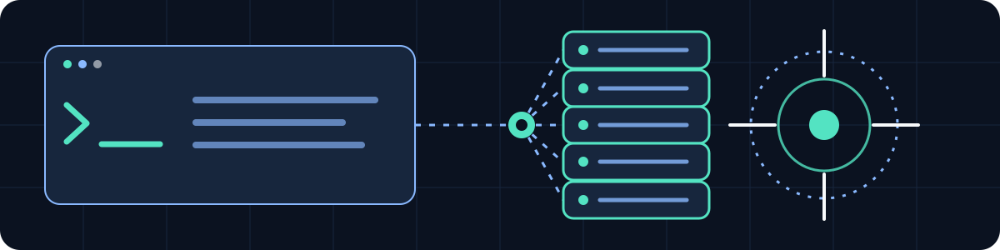
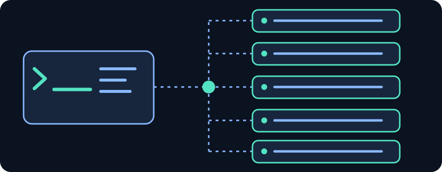
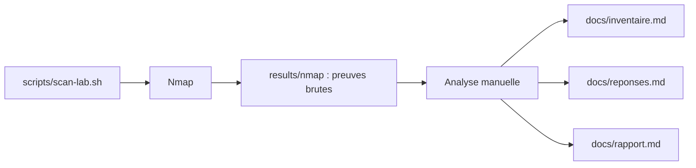

# NetRecon Lab

**Module 184 // Audit réseau avec Nmap**

Laboratoire pédagogique de reconnaissance réseau sur Kali Linux : découvrir cinq hôtes autorisés, relever leurs services TCP/UDP et documenter des observations vérifiables, sans exploitation.

[](LICENSE)


> [!IMPORTANT]
> **Périmètre strict : `10.99.0.10` à `10.99.0.14` exclusivement.**
> Ne pas scanner le réseau `/24` : à partir de `.100`, des machines appartiennent à d'autres élèves.
> Aucun brute force, aucune exploitation ni tentative d'accès non autorisé.
> Pour cet exercice, utiliser uniquement Nmap, `ping`, `nc` et `curl` pour les vérifications réseau.

## Objectif

Reconstituer la documentation d'une succursale de laboratoire à partir d'observations : présence des hôtes, MAC et fabricant lorsqu'ils sont visibles, ports TCP/UDP, services, versions, systèmes d'exploitation probables et risques associés. Le travail comprend la recherche d'un code `LAB{...}` réellement observé et la proposition de **trois mesures de sécurité justifiées**.

**Aucun résultat de scan n'est fourni.** L'inventaire, les constats et le code éventuel sont à compléter dans le laboratoire.

 

## Fonctionnalités

Le script [`scripts/scan-lab.sh`](scripts/scan-lab.sh) accepte sept modes et l'option `--dry-run` :

| Mode | Action confirmée dans le script |
| --- | --- |
| `discover` | Découverte des cinq IP avec `-sn`, sans scan de ports |
| `default` | Scan TCP par défaut, séparément pour chaque IP |
| `full` | Tous les ports TCP avec `-p-`, séparément pour chaque IP |
| `versions` | Tous les ports TCP et identification des services avec `-sV -p-` |
| `verify` | Scan des ports TCP 22, 80 et 443 avec `-Pn`, sans découverte préalable |
| `os` | Estimation du système d'exploitation avec `-O` et `sudo` si nécessaire |
| `udp` | Scan UDP des ports 53, 67, 137 et 161 avec `-sU` et `sudo` si nécessaire |

Toutes les commandes du script utilisent `-n` (sans résolution DNS inverse) et `-oA` (exports `.nmap`, `.xml`, `.gnmap`). Les cibles sont codées en dur et aucune adresse supplémentaire ne peut être passée en argument.

## Aperçu



*Illustration conceptuelle, ni capture d'écran ni topologie observée. Les preuves réelles doivent être produites dans le laboratoire et consignées dans `results/`.*

## Prérequis

- **Kali Linux**, connecté au réseau autorisé du laboratoire.
- **Bash**, **Nmap** et **Git** pour récupérer et exécuter le projet.
- `sudo` pour les modes `os` et `udp` si l'utilisateur n'est pas root.
- `ping`, `nc` et `curl` pour les vérifications manuelles décrites dans [`docs/commandes.md`](docs/commandes.md).

Le dépôt ne fixe **aucune version minimale** de Kali Linux, Bash ou Nmap. Relever les versions réellement utilisées plutôt que supposer une compatibilité précise :

```bash
bash --version
nmap --version
git --version
command -v ping
command -v nc
command -v curl
ip -br a
ip route
```

Avant tout scan, confirmer l'interface, la route et l'autorisation d'accès au réseau du laboratoire. Ne pas lancer cet exercice depuis un réseau domestique ou un autre environnement.

## Installation

```bash
git clone https://github.com/RufusTheDwarf/NetRecon-Lab.git
cd NetRecon-Lab
```

Aucune installation de dépendances applicatives, image Docker ou configuration `.env` n'est fournie dans ce dépôt. Les outils système doivent être disponibles sur Kali Linux.

## Utilisation

Commencer par afficher les commandes **sans exécuter de scan** :

```bash
bash scripts/scan-lab.sh discover --dry-run
bash scripts/scan-lab.sh versions --dry-run
```

Après vérification du périmètre et de l'environnement, choisir le mode souhaité :

```bash
bash scripts/scan-lab.sh discover
bash scripts/scan-lab.sh default
bash scripts/scan-lab.sh full
bash scripts/scan-lab.sh versions
bash scripts/scan-lab.sh verify
bash scripts/scan-lab.sh os
bash scripts/scan-lab.sh udp
```

Le mode `--dry-run` fonctionne aussi avec chacun des sept modes. Le script enregistre les sorties dans `results/nmap/` sous la forme `AAAAMMJJ-HHMMSS-mode-cible.{nmap,xml,gnmap}`. Les modes à cinq hôtes produisent un ensemble de fichiers par hôte ; `discover` produit un ensemble global.

**Attention :** un scan relancé avec le même mode au cours de la même seconde peut réutiliser un nom d'export. Les modes `os` et `udp` peuvent créer des fichiers appartenant à root. Les scans TCP complets et UDP peuvent être longs.

`verify` ne prouve pas qu'un hôte répond : `-Pn` ignore simplement l'étape de découverte. De même, un port UDP `open|filtered` n'est pas une preuve qu'un service est ouvert.

## Architecture et documentation



Les fichiers à compléter sont :

- [`docs/commandes.md`](docs/commandes.md) : aide-mémoire Nmap et vérifications `nc` / `curl`.
- [`docs/reponses.md`](docs/reponses.md) : préparation, parties 1 à 5 et réflexion, avec preuves.
- [`docs/inventaire.md`](docs/inventaire.md) : une ligne par hôte, puis par port observé.
- [`docs/rapport.md`](docs/rapport.md) : synthèse, traçabilité et trois constats de sécurité prioritaires.
- `results/nmap/` : fichiers générés par les scans ; `results/preuves/` : preuves complémentaires non sensibles.

Ne renseigner un service, une version, un rôle probable ou un code `LAB{...}` qu'à partir d'une observation documentée. Différencier faits, hypothèses et incertitudes.

## Configuration

Le script ne lit aucun fichier de configuration et **n'expose aucune variable d'environnement à renseigner**. Les cinq IP sont définies directement dans le tableau `TARGETS` de `scripts/scan-lab.sh`. Les sorties sont écrites relativement à la racine du dépôt, quel que soit le répertoire depuis lequel le script est lancé.

Pour les exemples de vérification manuelle, les ports `12345` et `8080` cités dans `docs/commandes.md` sont uniquement des exemples de syntaxe, **pas des services découverts**.

## Arborescence du dépôt audité

```text
NetRecon-Lab/
├── .editorconfig
├── .gitignore
├── LICENSE
├── README.md
├── docs/
│   ├── commandes.md
│   ├── inventaire.md
│   ├── rapport.md
│   └── reponses.md
├── results/
│   ├── nmap/
│   │   └── .gitkeep
│   └── preuves/
│       └── .gitkeep
└── scripts/
    └── scan-lab.sh
```

Les SVG référencés dans ce README sont des **assets proposés à ajouter** sous `assets/`. Ils ne font pas partie de l'arborescence ci-dessus, qui reflète la branche `main` auditée.

## Vérification

Contrôles locaux sans trafic réseau :

```bash
bash -n scripts/scan-lab.sh
bash scripts/scan-lab.sh udp --dry-run
bash scripts/scan-lab.sh versions --dry-run
```

Le dépôt ne contient ni suite de tests automatisés ni workflow CI. Ces commandes contrôlent seulement la syntaxe Bash et l'affichage des commandes prévues ; elles ne valident pas les résultats réseau.

## Sécurité et limites

Le périmètre du script est fixe, mais l'**autorisation effective** de scanner dépend de l'environnement. Respecter les consignes du cours, ne pas élargir la plage et ne pas effectuer d'exploitation.

Le dépôt GitHub est **public**. Le fichier `.gitignore` n'exclut pas les exports Nmap générés : **ne pas les publier sans autorisation et revue préalable**. Ces fichiers peuvent révéler adresses MAC, services et bannières. Ne jamais committer mots de passe, tokens, clés privées, captures sensibles ou supports de cours non redistribuables.

Nmap infère certaines informations à partir de réponses réseau. Un hôte silencieux peut être présent ; un port `filtered` ou `open|filtered` demeure incertain ; l'identification des versions et des OS peut être approximative. Les résultats complets, la disponibilité réelle des cinq machines et le code du laboratoire ne sont pas vérifiables depuis ce dépôt.

## Contribution

Signaler les erreurs documentaires ou les incohérences reproductibles via les [issues du dépôt](https://github.com/RufusTheDwarf/NetRecon-Lab/issues). Éviter toute publication de preuves contenant des informations sensibles. Les contributions restent soumises à la licence du projet et aux autorisations du laboratoire.

## Licence

Projet sous licence **MIT**. Voir [`LICENSE`](LICENSE), copyright **2026 Rufus**. La licence du dépôt ne remplace pas les conditions propres aux outils tiers et aux supports pédagogiques.

## Remerciements et références

- **Rufus** : auteur crédité dans [`LICENSE`](LICENSE), propriétaire du dépôt via [RufusTheDwarf](https://github.com/RufusTheDwarf).
- **Projet [Nmap](https://nmap.org/)** : outil central du laboratoire, avec son [manuel officiel](https://nmap.org/book/man.html), sa [documentation des sorties](https://nmap.org/book/man-output.html) et sa [documentation de découverte des hôtes](https://nmap.org/book/host-discovery-techniques.html). Nmap conserve ses propres conditions de licence.
- **Supports pédagogiques mentionnés dans le README original** : `E-184-ALL-UtiliserNmap.md`, `S-184-Semaine_1.pdf`, `S-184-Semaine_2.pdf`. Ces fichiers ne sont pas présents dans le dépôt et ne sont pas redistribués ici.
- **Bash et Git** : outils système utilisés ; documentation de [Bash](https://www.gnu.org/software/bash/manual/) et de [Git](https://git-scm.com/docs/git-clone).
- **Illustrations** : SVG originaux fournis avec cette proposition de README, sans logos ni ressources graphiques tierces.


