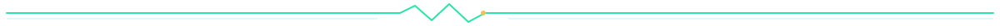
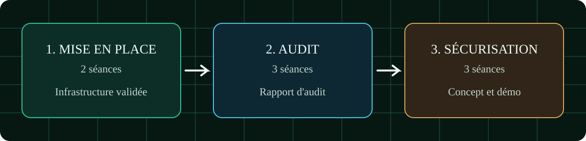
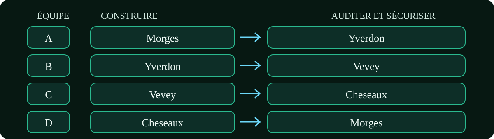
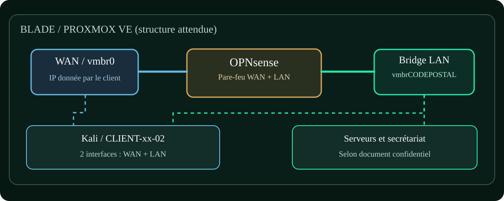
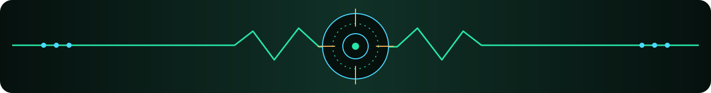

<div align="center">


# NETRECON LAB

**MODULE 184 // PROJET FIDUVENNES // IMPLÉMENTER LA SÉCURITÉ RÉSEAU**

Documentation de préparation d'un projet d'infrastructure, d'audit et de sécurisation de succursales fictives, à partir du cahier des charges FiduVennes.

<p>
<a href="https://github.com/RufusTheDwarf/NetRecon-Lab"></a>
<a href="LICENSE"></a>
<a href="https://www.proxmox.com/en/products/proxmox-virtual-environment/overview"></a>
<a href="https://opnsense.org/"></a>
<a href="https://www.kali.org/"></a>
<a href="https://nmap.org/"></a>
<a href="scripts/scan-lab.sh"></a>
</p>

<p>


</p>

<p>
<a href="https://github.com/RufusTheDwarf/NetRecon-Lab/stargazers"></a>
<a href="https://github.com/RufusTheDwarf/NetRecon-Lab/forks"></a>
<a href="https://github.com/RufusTheDwarf/NetRecon-Lab/issues"></a>
<a href="https://github.com/RufusTheDwarf/NetRecon-Lab/commits/main"></a>
<a href="https://github.com/RufusTheDwarf/NetRecon-Lab/tree/main"></a>
</p>

[**Dépôt**](https://github.com/RufusTheDwarf/NetRecon-Lab) · [**Code existant**](scripts/scan-lab.sh) · [**Documentation Nmap**](https://nmap.org/book/man.html) · [**Licence**](LICENSE)

</div>

<p align="center"></p>

> [!IMPORTANT]
> **Ce README est un support de préparation et d'organisation, pas un livrable d'audit ni un concept de sécurité.** L'étape 1 doit reproduire exactement la configuration décrite pour la succursale attribuée, même si elle semble peu sûre. L'audit nécessite une autorisation écrite, est non destructif et se limite à la succursale attribuée. Toute étape doit être validée par l'enseignant avant de passer à la suivante.

##  01 / Contexte : FiduVennes

**FiduVennes SA** a racheté quatre fiduciaires vaudoises. Les responsables IT de ces succursales ont démissionné avant la centralisation informatique à Vennes. La documentation technique des sites constitue la base du projet.

Les équipes prennent successivement trois rôles : **intégrateur**, **auditeur**, puis **responsable de la sécurisation**. La mission porte sur **8 séances** et implique un transfert unique de succursale après la mise en place. La succursale auditée en étape 2 reste celle que l'équipe sécurise en étape 3.

Ce dépôt conserve son nom **NetRecon-Lab**, mais le sujet du module 184 dépasse désormais Nmap : il inclut Proxmox VE, OPNsense, des machines virtuelles, un poste Kali à deux interfaces, des contrôles de services, un audit et des mesures de sécurité.

**État constaté du dépôt :** le script de reconnaissance et les documents précédents restent ceux d'un premier laboratoire Nmap. La nouvelle infrastructure FiduVennes n'est pas implémentée dans le dépôt audité.

##  02 / Les trois étapes du projet

<div align="center">

<sub>Schéma organisationnel adapté du cahier des charges, sans indication d'avancement réel.</sub>
</div>

| Étape | Séances | Mission | Livrable |
| :---: | :---: | :--- | :--- |
| **1. Mise en place** | 1 à 2 | Reconstruire exactement l'infrastructure de la succursale confiée | Infrastructure validée |
| **2. Audit** | 3 à 5 | Examiner une succursale construite par une autre équipe | Rapport d'audit |
| **3. Sécurisation** | 6 à 8 | Corriger les problèmes identifiés sans casser les besoins métier | Concept de sécurité et démonstration |

L'enseignant représente le **client**. Il contrôle et valide chaque étape avant d'autoriser la suivante. Le calendrier ci-dessus correspond aux échéances du cahier des charges, pas à l'avancement de l'équipe.

##  03 / Équipes, succursales et rotation

| Équipe | Succursale à construire | Ancienne fiduciaire | Code | Succursale à auditer et sécuriser |
| :---: | :--- | :--- | :---: | :--- |
| **A** | Morges | Fidu Zizelettes | `MOS` | Yverdon |
| **B** | Yverdon | Fidu Tya-Bailli | `YVN` | Vevey |
| **C** | Vevey | Fidu Pâtés-Froids | `VEY` | Cheseaux |
| **D** | Cheseaux | Fidu Gremauds | `CHX` | Morges |

<div align="center">

<sub>Flèches : succursale construite vers succursale auditée puis sécurisée.</sub>
</div>

**Équipe personnelle et succursale attribuée : non renseignées.** Le cahier des charges ne donne pas les noms des membres. Aucune équipe n'est supposée être la vôtre.

##  04 / Plan d'adressage officiel

Les réseaux des succursales appartiennent au bloc `10.30.0.0/16`. Le **troisième octet** du LAN reprend les deux premiers chiffres du code postal ; le **bridge Proxmox** utilise le code postal entier.

| Succursale | Code postal | Réseau LAN | Bridge interne |
| :--- | :---: | :--- | :--- |
| Morges | `1110` | `10.30.11.0/24` | `vmbr1110` |
| Yverdon | `1400` | `10.30.14.0/24` | `vmbr1400` |
| Vevey | `1800` | `10.30.18.0/24` | `vmbr1800` |
| Cheseaux | `1033` | `10.30.10.0/24` | `vmbr1033` |

Dans chaque LAN, la répartition prévue est identique :

| Adresse ou plage | Usage prévu |
| :--- | :--- |
| `.1` | Interface LAN du pare-feu, passerelle et DNS |
| `.10` à `.19` | Serveurs en IP fixes |
| `.20` à `.29` | Postes clients en IP fixes |
| `.100` à `.199` | Plage réservée au DHCP |

**Important :** les plages sont des règles de conception, pas une liste de machines déjà installées ni une autorisation de scanner toute la plage. Le côté WAN du pare-feu est relié à `vmbr0` ; **son adresse est communiquée par l'enseignant**, et ne doit pas être inventée.

##  05 / Architecture attendue

<div align="center">

<sub>Vue logique issue du cahier des charges, pas un schéma d'infrastructure déployée.</sub>
</div>

- **Blade / Proxmox VE** : plateforme de virtualisation de la succursale.
- **`vmbr0`** : bridge du côté WAN d'OPNsense.
- **`vmbrXXXX`** : bridge LAN interne de la succursale, selon le code postal.
- **OPNsense** : pare-feu avec une interface WAN et une interface LAN ; l'IP LAN se termine par `.1`.
- **Poste Kali `CLIENT-xx-02`** : poste du service informatique, avec **une interface WAN et une interface LAN permanentes**. Il sert à configurer les machines à l'étape 1 et à tester la succursale aux étapes 2 et 3.
- **Serveurs et poste du secrétariat** : à installer selon le document technique confidentiel propre à la succursale.

Les machines sont nommées `TYPE-SITE-NN` ou `TYPE-SITE-RÔLE`, par exemple `FW-MOS-01` et `SRV-MOS-WEB`. Ces noms sont des **exemples de convention**, pas la preuve de présence des machines.

##  06 / Étape 1 : mise en place (séances 1 et 2)

L'équipe reçoit une blade, une clé USB, le document technique de sa succursale et les fichiers de données associés.

La préparation peut suivre cet ordre, **sans remplacer les consignes propres à la succursale** :

1. Installer **Proxmox VE** sur la blade.
2. Créer le **bridge interne** approprié.
3. Préparer le poste informatique **`CLIENT-xx-02`**.
4. Installer **OPNsense**, avec WAN sur `vmbr0` et LAN sur le bridge interne.
5. Installer les serveurs et le poste du secrétariat définis dans le document de la succursale.
6. Contrôler chaque service demandé et noter le résultat dans le journal.

> [!CAUTION]
> **Ne pas sécuriser prématurément l'infrastructure pendant l'étape 1.** Le cahier des charges demande de reproduire le document à la lettre, même lorsqu'une configuration paraît peu sûre. Si un point manque ou paraît ambigu, interroger l'enseignant-client ; ne pas inventer de configuration. Le document technique de la succursale est confidentiel et ne doit pas être partagé avec les autres équipes.

La validation de fin d'étape repose sur le contrôle des services par l'enseignant et la remise de la **liste des comptes des machines** par le canal demandé. Ne pas déposer cette liste, les identifiants ou les fichiers confidentiels dans ce dépôt public.

##  07 / Étape 2 : audit de sécurité (séances 3 à 5)

L'équipe reçoit **une autorisation écrite FiduVennes**, l'accès au poste `CLIENT-xx-02` de la succursale cible et le guide de l'étape 2. Elle audite une infrastructure montée par une autre équipe.

| Perspective | Point de départ | Objectif |
| :--- | :--- | :--- |
| **Audit externe** | Interface **WAN** du poste Kali | Observer les services accessibles du point de vue extérieur prévu par le laboratoire |
| **Audit interne** | Interface **LAN** du même poste Kali | Observer les services atteignables depuis le réseau de la succursale |

L'audit doit rester **non destructif** : aucune donnée supprimée ou modifiée, aucun changement de mot de passe et aucune attaque par déni de service. Les autres blades, les autres succursales et le réseau de l'école sont hors périmètre. Le guide de l'étape 2 et l'autorisation écrite déterminent les tests permis.

Le livrable est un **rapport d'audit rédigé par l'équipe**, avec une preuve (commande et résultat), une gravité et le risque pour la fiduciaire pour chaque faille. Ce README n'est pas ce rapport.

##  08 / Étape 3 : sécurisation (séances 6 à 8)

Après l'audit, l'équipe conserve **la même succursale** et reçoit les comptes administrateur ainsi que le guide de l'étape 3.

Les attentes du cahier des charges sont :

1. Rédiger un **concept de sécurité** qui propose une mesure par faille du rapport, avec une priorité.
2. Tenir compte du **besoin métier** : une correction ne doit pas rendre impossible une fonction nécessaire, par exemple le travail à distance de la secrétaire si celui-ci était prévu.
3. Appliquer les mesures autorisées sur l'infrastructure.
4. **Rejouer les tests de l'étape 2** pour démontrer le résultat avant/après.

Les livrables sont un **document de concept et de mesures appliquées**, puis une **démonstration devant l'enseignant**. Les preuves et conclusions finales doivent provenir des actions de l'équipe, pas de démonstrations inventées.

##  09 / Calendrier et livrables

| Échéance | Travail attendu | Nature |
| :--- | :--- | :--- |
| **Fin de séance 2** | Infrastructure de la succursale validée par l'enseignant | Par équipe |
| **Fin de séance 5** | Rapport d'audit, selon le template FiduVennes | Par équipe |
| **Fin de séance 8** | Concept de sécurité et démonstration | Par équipe |
| **Chaque séance** | Journal de travail avec date, tâches, problèmes et solutions | Individuel |
| **Séance 8** | Journal individuel et registre des demandes IA | Remise finale selon le cahier des charges |

**Les templates FiduVennes de rapport, de concept et de registre IA ne sont pas présents dans le dépôt audité.** Ils ne sont pas reconstitués ici. Le statut des étapes reste à renseigner par l'équipe et à faire valider par l'enseignant.

##  10 / Journal de travail et traçabilité

Chaque personne doit tenir son **journal individuel**, mis à jour à chaque séance. Le cahier des charges demande au minimum : date, tâches effectuées, problèmes rencontrés et solutions mises en œuvre.

Pour faciliter la vérification sans inventer les observations, l'équipe peut organiser ses notes autour des questions suivantes :

- Quel était l'objectif de la séance et quel document de référence a été utilisé ?
- Qu'a-t-on réellement réalisé et vérifié ?
- Quel problème a été rencontré, et comment a-t-il été traité ?
- Quelles décisions nécessitent l'accord de l'enseignant-client ?
- Quelle preuve, non sensible et autorisée à être conservée, permet de retracer l'étape ?

Le format est libre. Les journaux sont contrôlés à chaque validation et rendus en séance 8. Ce README propose seulement une méthode de préparation, **pas un journal individuel généré**.

##  11 / Usage de l'IA : AIAS niveau 2

> [!WARNING]
> **L'IA est autorisée uniquement pour la préparation** : recherche d'informations, exploration de pistes, idées et structuration d'un plan. La réalisation reste celle des élèves. **La configuration des machines, le rapport d'audit et le concept de sécurité remis comme livrables doivent être produits par l'équipe sans contenu rédigé ou généré par l'IA.**

Chaque recours à l'IA doit être consigné dans le **registre des demandes IA fourni par FiduVennes** : demande formulée, outil utilisé et utilisation effective du résultat. Le cahier des charges précise qu'un usage non consigné peut empêcher la validation du travail.

La préparation de ce README avec une IA constitue donc **un recours à déclarer** si ce travail est utilisé dans le cadre du projet. Le présent document est un support de préparation, pas un substitut aux productions évaluées.

##  12 / Contenu réel du dépôt

Le dépôt héberge encore les éléments de l'exercice Nmap précédent :

| Chemin existant | État constaté |
| :--- | :--- |
| [`scripts/scan-lab.sh`](scripts/scan-lab.sh) | Script Bash de sept modes, cibles héritées `10.99.0.10-14` |
| [`docs/commandes.md`](docs/commandes.md) | Exemples de commandes pour l'ancien périmètre |
| [`docs/inventaire.md`](docs/inventaire.md) | Modèle d'inventaire du précédent laboratoire |
| [`docs/reponses.md`](docs/reponses.md) | Modèle des réponses du précédent exercice |
| [`docs/rapport.md`](docs/rapport.md) | Modèle de rapport précédent, **pas** le template FiduVennes reçu par l'équipe |
| `results/nmap/` et `results/preuves/` | Répertoires contenant seulement des `.gitkeep` |
| `assets/` | Illustrations et icônes du README |
| [`LICENSE`](LICENSE) | Licence MIT, copyright 2026 Rufus |

**Le projet FiduVennes n'est pas encore configuré, déployé ou audité dans ce dépôt.** Les quatre sites et les services évoqués ci-dessus sont des exigences du cahier des charges, pas des composants attestés dans le code.

##  13 / Ancien script Nmap : incompatibilité de périmètre

Le script existant **ne doit pas être utilisé tel quel sur FiduVennes**. Il contient explicitement :

```text
10.99.0.10
10.99.0.11
10.99.0.12
10.99.0.13
10.99.0.14
```

Le cahier des charges FiduVennes décrit au contraire les LAN `10.30.11.0/24`, `10.30.14.0/24`, `10.30.18.0/24` et `10.30.10.0/24`. **Aucune de ces plages ne peut être considérée comme un périmètre de scan autorisé dans son intégralité.** L'autorisation écrite, la succursale attribuée et le guide d'audit font foi.

Le script accepte toujours `--dry-run`, qui permet d'inspecter les commandes **sans trafic réseau** :

```bash
bash scripts/scan-lab.sh discover --dry-run
```

Cette commande sert uniquement à constater les cibles codées en dur. **Ne pas lancer les modes actifs** avant de disposer du nouveau périmètre exact, des autorisations et d'une adaptation réalisée puis vérifiée par l'équipe. Les versions minimales des outils et les configurations de la nouvelle infrastructure ne sont pas spécifiées par le README existant.

##  14 / Confidentialité et contrôle du périmètre

- **Succursale attribuée seulement** : ni réseau de l'école, ni autre blade, ni autre équipe.
- **Autorisation écrite** et durée du projet : les tests ne sont permis que dans ces limites.
- **Étape 1** : documents confidentiels non partagés, configuration fidèlement reconstruite.
- **Étape 2** : tests non destructifs, aucune suppression, modification, rotation de mots de passe ou déni de service.
- **Étape 3** : corrections après validation, avec maintien du fonctionnement métier.
- **Dépôt public** : aucune publication de comptes, mots de passe, adresses WAN attribuées par l'enseignant, exports de scan sensibles ou documents confidentiels.

Le `.gitignore` existant ne masque pas les exports Nmap. L'autorisation de réaliser des tests **n'est pas une autorisation de publier leurs résultats**. Prévoir une revue avant toute mise en ligne.

##  15 / Informations encore nécessaires

Le cahier des charges commun fixe le cadre du projet, mais **ne permet pas à lui seul de réaliser les étapes**. Les éléments suivants doivent venir de l'enseignant ou de l'équipe :

- Composition de l'équipe et succursale qui lui est attribuée.
- Document technique confidentiel de la succursale pour l'étape 1 et ses fichiers de données.
- Adresse du côté WAN du pare-feu et éléments d'accès transmis par le client.
- Autorisation écrite et guide de l'étape 2, notamment le périmètre de test exact.
- Guide et comptes administrateur de l'étape 3.
- Templates FiduVennes du rapport d'audit, du concept de sécurité et du registre IA.
- Observations réelles, validations de l'enseignant et dates des séances.

Aucun de ces éléments manquants n'est deviné ni déclaré comme déjà disponible dans GitHub.

##  16 / Licence, références et remerciements

**Licence du dépôt :** [MIT](LICENSE), `Copyright (c) 2026 Rufus`. La licence ne s'étend pas automatiquement aux supports pédagogiques, marques ou documents confidentiels de tiers.

**Crédits et références :**

- **[RufusTheDwarf](https://github.com/RufusTheDwarf)** : propriétaire et auteur du dépôt ; la licence crédite Rufus.
- **ETML, module 184**, et **FiduVennes SA**, scénario pédagogique du cahier des charges transmis. Le document reste soumis aux règles de diffusion du cours.
- **[Proxmox VE](https://www.proxmox.com/en/products/proxmox-virtual-environment/overview)** : virtualisation demandée à l'étape 1.
- **[OPNsense](https://opnsense.org/)** : pare-feu WAN/LAN demandé à l'étape 1, documentation des [interfaces](https://docs.opnsense.org/manual/interfaces.html).
- **[Kali Linux](https://www.kali.org/)** : poste technique prévu dans chaque succursale.
- **[Nmap Project](https://nmap.org/)** : outil de reconnaissance du script initial et [documentation officielle](https://nmap.org/book/man.html).
- **[GNU Bash](https://www.gnu.org/software/bash/manual/)** et **[Git](https://git-scm.com/docs/git-clone)** : outils associés au dépôt.
- **[Capsule Render](https://github.com/kyechan99/capsule-render)** : grand header animé généré par son service, sans fichier `header-wide.svg` local.
- **[Readme Typing SVG](https://github.com/DenverCoder1/readme-typing-svg)** : sous-titre animé.
- **[Shields.io](https://shields.io/)** : badges. Les marques affichées dans les badges restent la propriété de leurs titulaires.
- **Illustrations** : trois schémas SVG originaux et les icônes de sections conservées dans le dépôt, utilisés comme schémas conceptuels et non comme captures réelles.
- **Références de l'ancien exercice** : `E-184-ALL-UtiliserNmap.md`, `S-184-Semaine_1.pdf`, `S-184-Semaine_2.pdf`, mentionnés dans le README précédent mais non redistribués ici.

<p align="center"></p>

<div align="center">

### BUILD // AUDIT // SECURE

**Infrastructure vérifiée. Audit autorisé. Sécurisation démontrée.**

[](https://github.com/RufusTheDwarf)
[](https://github.com/RufusTheDwarf/NetRecon-Lab)
[](LICENSE)

[**Dépôt GitHub**](https://github.com/RufusTheDwarf/NetRecon-Lab) · [**Signaler une erreur**](https://github.com/RufusTheDwarf/NetRecon-Lab/issues) · [**Licence**](LICENSE)




<sub>NETRECON LAB // FIDUVENNES // MODULE 184 // 2026 // RUFUSTHEDWARF</sub>

</div>
