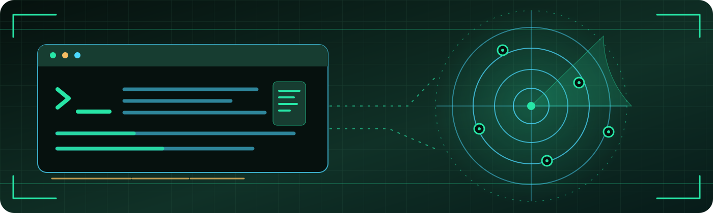
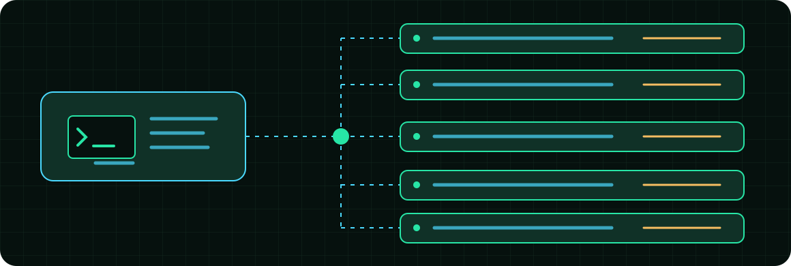
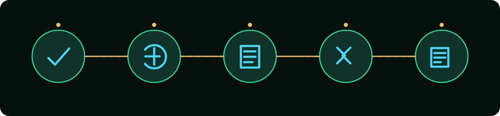
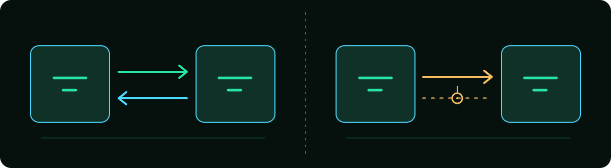
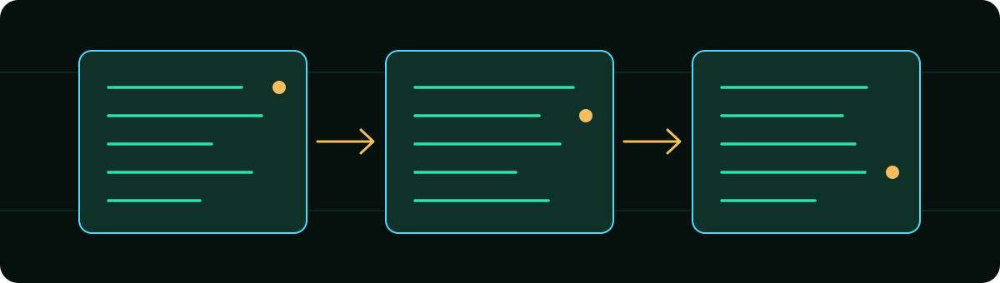
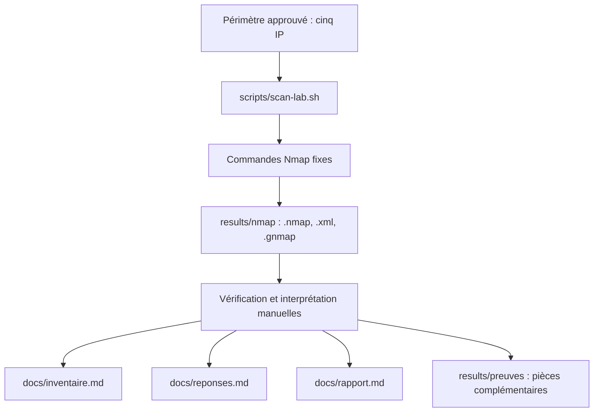

<div align="center">



# NETRECON LAB

**MODULE 184 // NETWORK RECONNAISSANCE // DOCUMENTED EVIDENCE**


**Reconnaissance réseau encadrée avec Nmap, Bash et Kali Linux.**

Un projet pédagogique pour découvrir un périmètre autorisé, identifier ses services et produire un rapport fondé sur des preuves.

<p>
<a href="https://github.com/RufusTheDwarf/NetRecon-Lab"></a>
<a href="LICENSE"></a>
<a href="scripts/scan-lab.sh"></a>
<a href="https://nmap.org/"></a>
<a href="https://www.kali.org/"></a>
<a href="README.md"></a>
</p>

<p>
<a href="scripts/scan-lab.sh"></a>
<a href="scripts/scan-lab.sh"></a>
<a href="scripts/scan-lab.sh"></a>
<a href="scripts/scan-lab.sh"></a>
<a href="scripts/scan-lab.sh"></a>
</p>

<p>
<a href="https://github.com/RufusTheDwarf/NetRecon-Lab/stargazers"></a>
<a href="https://github.com/RufusTheDwarf/NetRecon-Lab/forks"></a>
<a href="https://github.com/RufusTheDwarf/NetRecon-Lab/issues"></a>
<a href="https://github.com/RufusTheDwarf/NetRecon-Lab/commits/main"></a>
<a href="https://github.com/RufusTheDwarf/NetRecon-Lab/tree/main"></a>
</p>

[**Source**](https://github.com/RufusTheDwarf/NetRecon-Lab) · [**Guide des commandes**](docs/commandes.md) · [**Inventaire**](docs/inventaire.md) · [**Rapport**](docs/rapport.md) · [**Documentation Nmap**](https://nmap.org/book/man.html)

</div>

<p align="center"></p>

> [!IMPORTANT]
> **Périmètre autorisé : `10.99.0.10`, `10.99.0.11`, `10.99.0.12`, `10.99.0.13` et `10.99.0.14` uniquement.**
> Le reste du réseau est hors scope. Ne pas scanner le `/24` entier : à partir de `.100`, les machines appartiennent à d'autres élèves. Aucun brute force, aucune exploitation et aucune tentative d'accès non autorisé.

##  01 / Présentation

**NetRecon Lab** est un laboratoire d'analyse réseau créé pour le module 184. L'exercice consiste à reconstituer la documentation d'une succursale fictive ou isolée, non à réaliser une intrusion. On utilise les réponses réseau obtenues par Nmap pour décrire les hôtes, comprendre les services proposés et identifier des points de vigilance.

Le dépôt réunit trois éléments complémentaires :

- **Un script Bash opérationnel** pour lancer sept catégories de scans Nmap sur une liste fixe d'IP.
- **Des supports de travail** pour comparer les résultats, inventorier les machines et préparer les réponses de l'exercice.
- **Des emplacements pour preuves** permettant de rattacher chaque affirmation à une commande, une date, une cible et un fichier exporté.

Les observations sont à relever dans le laboratoire. Les fichiers `docs/inventaire.md`, `docs/reponses.md` et `docs/rapport.md` contiennent actuellement des modèles, **pas des résultats validés**.

<p align="center">
<a href="scripts/scan-lab.sh"></a>
<a href="docs/rapport.md"></a>
<a href="results/nmap/"></a>
</p>

##  02 / Périmètre autorisé

La liste des cibles est inscrite directement dans `scripts/scan-lab.sh`. Le programme ne propose ni argument `--target`, ni lecture de plage depuis un fichier, ni saisie libre d'une adresse.

| Adresse | Dans le périmètre | État de l'hôte |
| :--- | :---: | :--- |
| `10.99.0.10` | Oui | À observer |
| `10.99.0.11` | Oui | À observer |
| `10.99.0.12` | Oui | À observer |
| `10.99.0.13` | Oui | À observer |
| `10.99.0.14` | Oui | À observer |

> **Cinq cibles prévues ne signifient pas cinq hôtes actifs.** Une machine peut ne pas répondre à la découverte, être éteinte ou filtrer certaines sondes.

<div align="center">


<sub>Illustration conceptuelle du périmètre. Aucune topologie réelle ni aucun service découvert ne sont représentés.</sub>
</div>

Le réseau doit être celui du laboratoire. Vérifier avant l'exécution l'interface Kali, la table de routage, et l'autorisation de l'enseignant ou du responsable du réseau. Pour cet exercice, les vérifications manuelles se limitent à **Nmap, `ping`, `nc` et `curl`**.

<p align="center"></p>

##  03 / Objectifs du laboratoire

Chaque phase doit déboucher sur une observation et, lorsque c'est possible, sur une preuve exportée.

| Phase | Question à résoudre | Livrable attendu |
| :---: | :--- | :--- |
| 01 | Quelles adresses répondent ? | Inventaire de découverte, MAC et fabricant si visibles |
| 02 | Quels ports TCP sont accessibles ? | Comparaison scan standard / scan complet |
| 03 | Quels services utilisent ces ports ? | Protocoles, noms, versions et incertitudes |
| 04 | Quel OS semble utilisé ? | Estimation Nmap et niveau de confiance |
| 05 | Les observations peuvent-elles être vérifiées ? | Vérifications `nc` ou `curl` sur ports réellement observés |
| 06 | Que révèlent les ports UDP ciblés ? | Interprétation des états UDP |
| 07 | Quels risques méritent une correction ? | Trois constats et recommandations fondés sur des preuves |

Le code `LAB{...}` demandé par l'exercice doit être noté **uniquement s'il est réellement découvert**, avec la méthode et la preuve correspondantes. Il n'est pas présent dans ce README.

<div align="center">
<sub>Cycle de travail illustratif. Les résultats dépendent des observations réalisées.</sub></div>

##  04 / Ce que contient le projet

Le cœur du dépôt est [`scripts/scan-lab.sh`](scripts/scan-lab.sh), un script Bash utilisant `set -euo pipefail`, un tableau constant `TARGETS`, une validation des arguments et un répertoire de sortie calculé à partir de son emplacement sur disque.

**Fonctions confirmées dans le code :**

- Sélection d'un mode parmi `discover`, `default`, `full`, `versions`, `verify`, `os` et `udp`.
- Acceptation facultative de `--dry-run` en deuxième et dernier argument.
- Vérification de la présence de `nmap` pour les scans exécutés.
- Vérification de `sudo` pour les modes nécessitant des privilèges lorsqu'on n'est pas root.
- Ajout systématique de `-n` et de `-oA` aux commandes construites.
- Export daté dans `results/nmap/`, avec un ensemble par hôte pour les modes individuels.
- Affichage de la commande avant l'exécution pour faciliter la traçabilité.

**Ce qui n'est pas implémenté :** interface graphique, découverte automatique d'un sous-réseau arbitraire, scanner de vulnérabilités, exploitation, agrégation automatique des rapports, Docker et pipeline CI. Les documents de synthèse sont remplis manuellement.

##  05 / Prérequis et préparation

L'environnement prévu est **Kali Linux connecté au laboratoire autorisé**. Le dépôt ne fixe pas de version minimale de Kali Linux, Bash ou Nmap : il faut donc relever celles réellement utilisées, sans annoncer une compatibilité non testée.

| Élément | Rôle | Vérification |
| :--- | :--- | :--- |
| Kali Linux | Poste depuis lequel l'exercice est mené | `cat /etc/os-release` |
| Bash | Exécution du script | `bash --version` |
| Nmap | Découverte et scans | `nmap --version` |
| Git | Clonage du dépôt | `git --version` |
| `sudo` | Élévation pour les modes `os` et `udp` | `command -v sudo` |
| `ping`, `nc`, `curl` | Vérifications prévues par l'exercice | `command -v ping nc curl` |

Commandes de contrôle avant tout trafic réseau :

```bash
cat /etc/os-release
bash --version
nmap --version
git --version
command -v sudo
command -v ping nc curl
ip -br a
ip route
```

Les commandes `ip` servent à examiner les interfaces et routes. N'en déduis pas qu'une interface est forcément celle du laboratoire sans vérifier la configuration réelle.

<p align="center">
<a href="https://www.kali.org/docs/"></a>
<a href="https://www.gnu.org/software/bash/manual/"></a>
<a href="https://nmap.org/book/man.html"></a>
</p>

##  06 / Installation et première exécution

Cloner le dépôt depuis GitHub :

```bash
git clone https://github.com/RufusTheDwarf/NetRecon-Lab.git
cd NetRecon-Lab
```

Afficher d'abord ce que le script compte faire. `--dry-run` n'exécute pas Nmap et ne crée pas de fichiers de résultats.

```bash
bash scripts/scan-lab.sh discover --dry-run
bash scripts/scan-lab.sh default --dry-run
bash scripts/scan-lab.sh udp --dry-run
```

Vérifier que **chacune** des commandes imprimées contient exclusivement les cinq adresses autorisées. Vérifier ensuite l'interface Kali et la connectivité au réseau du laboratoire avec le responsable de l'exercice.

Une fois ce contrôle terminé :

```bash
# Découverte sans scan de ports
bash scripts/scan-lab.sh discover

# Scan TCP standard de chaque adresse
bash scripts/scan-lab.sh default
```

Le script se lance via Bash. Le rendre exécutable avec `chmod +x` n'est pas nécessaire avec cette méthode. Aucun fichier `.env` n'est chargé et aucun service n'est à démarrer.

> [!NOTE]
> Les modes `os` et `udp` demandent `sudo` si nécessaire. Selon l'environnement, une authentification peut être demandée. Le script écrit ses résultats relativement à la racine du dépôt, même lorsqu'il est lancé depuis un autre répertoire.

<p align="center"></p>

##  07 / Guide complet des sept modes

Chaque commande ci-dessous correspond à un mode existant dans le script. Dans tous les cas, les cibles restent fixes et la résolution DNS inverse est désactivée par `-n`.

### Découverte des machines : `discover`

```bash
bash scripts/scan-lab.sh discover
```

Utilise `-sn` pour chercher les hôtes répondants **sans scanner les ports**. Sur un même réseau Ethernet, une découverte ARP peut contribuer à identifier des MAC. Selon la topologie et les permissions, ces informations peuvent ne pas être disponibles. Un silence ne démontre pas qu'un équipement est éteint.

### Scan TCP standard : `default`

```bash
bash scripts/scan-lab.sh default
```

Nmap analyse par défaut les **1 000 ports TCP les plus fréquents**, pas tous les ports possibles. Il peut donc manquer un service écoutant sur un port plus rare. Le script lance ce contrôle individuellement sur les cinq adresses.

### Scan TCP complet : `full`

```bash
bash scripts/scan-lab.sh full
```

L'option `-p-` demande l'examen de tous les ports TCP numérotés de **1 à 65 535**. Comparer les résultats avec ceux de `default` pour documenter les services éventuellement absents du scan standard. Le temps d'exécution dépend des réponses, du filtrage et de l'environnement.

### Détection des services : `versions`

```bash
bash scripts/scan-lab.sh versions
```

Combine `-sV` et `-p-` : Nmap tente de caractériser les services trouvés sur les ports TCP. Un numéro de port habituel ne garantit pas l'identité du service, et les versions affichées restent des observations ou des estimations. Par défaut, Nmap peut exclure certains ports de ses sondes de version (notamment TCP 9100) même si le scan de ports les couvre.

### Vérification ciblée : `verify`

```bash
bash scripts/scan-lab.sh verify
```

Combine `-Pn` et `-p 22,80,443` : Nmap tente les contrôles sur ces trois ports sans utiliser sa phase habituelle de découverte préalable. Le résultat doit être croisé avec d'autres observations : **`-Pn` n'est pas une preuve que la machine est active**.

### Estimation de l'OS : `os`

```bash
bash scripts/scan-lab.sh os
```

Utilise `-O`. La détection repose sur les caractéristiques des réponses et dépend des ports et de la topologie. Consigner les hypothèses et leur degré de confiance, sans convertir une estimation en identification certaine. Le script invoque `sudo` si besoin.

### UDP ciblé : `udp`

```bash
bash scripts/scan-lab.sh udp
```

Utilise `-sU` et `-p 53,67,137,161` sur les cinq adresses. Les ports sélectionnés sont historiquement associés à DNS, DHCP, NetBIOS et SNMP, mais **la présence d'un numéro de port ne prouve pas qu'un de ces services fonctionne réellement**. Les réponses UDP sont souvent moins concluantes que celles d'un scan TCP.

<div align="center">

<sub>Schéma conceptuel des échanges, simplifié à des fins pédagogiques.</sub>
</div>

##  08 / Comprendre les états Nmap

Nmap décrit **ce qu'il observe depuis sa position réseau**. Les états ne sont pas des propriétés permanentes des ports : firewall, routage, délai, protocole ou méthode de scan peuvent influer sur la conclusion.

| État | Interprétation correcte | Erreur à éviter |
| :--- | :--- | :--- |
| `open` | Un service semble accepter les connexions ou datagrammes correspondants | Supposer que le service est sûr ou authentifié |
| `closed` | Le port répond, mais aucun service ne semble écouter | En déduire que tout l'hôte est inutilisable |
| `filtered` | Le filtrage ou une absence de réponse empêche de déterminer l'ouverture | Le présenter comme un port fermé |
| `unfiltered` | Port accessible, mais état ouvert/fermé indéterminé pour ce type de scan | Le confondre avec `open` |
| `open|filtered` | Nmap ne distingue pas ouvert de filtré, fréquent en UDP | L'annoncer comme ouvert |
| `closed|filtered` | Nmap ne distingue pas fermé de filtré, dans certains scans spécifiques | L'annoncer comme définitivement fermé |

Pour les services : distinguer le **nom supposé par le port**, le **résultat de détection `-sV`** et la **preuve manuelle**. Pour les OS : indiquer explicitement le caractère estimé de la détection.

Voir [Port Scanning Basics](https://nmap.org/book/man-port-scanning-basics.html) et [Service and Version Detection](https://nmap.org/book/man-version-detection.html) dans la documentation officielle.

##  09 / Exports et traçabilité

Le script génère ses sorties dans `results/nmap/` en utilisant l'option Nmap `-oA` :

| Extension | Format | Usage conseillé |
| :---: | :--- | :--- |
| `.nmap` | Sortie textuelle normale | Lecture et citation humaine |
| `.xml` | Résultat XML structuré | Analyse automatique éventuelle |
| `.gnmap` | Ancien format grepable | Recherche textuelle simple, en connaissant ses limites |

Le nom de base suit le modèle `AAAAMMJJ-HHMMSS-mode-cible`. Le mode `discover` produit un groupe global nommé `hosts`. Les autres modes produisent un groupe par IP dont le suffixe est le dernier octet (`10`, `11`, `12`, `13`, `14`).

Les preuves doivent être reliées à la date, au contexte réseau, à la commande exécutée et à une conclusion précise. **Ne pas réécrire le contenu d'un export brut pour faire correspondre un résultat à une hypothèse.**

<div align="center">

<sub>De la preuve brute à une documentation interprétée. Schéma original.</sub>
</div>

**Attention aux collisions de noms :** deux lancements du même mode au cours de la même seconde peuvent produire les mêmes chemins. Le script ne met pas en place une protection contre l'écrasement. Des exports générés avec `sudo` peuvent également appartenir à root.

##  10 / Vérifications complémentaires

Le fichier [`docs/commandes.md`](docs/commandes.md) fournit un aide-mémoire pour la découverte, les ports TCP, les versions et les contrôles ciblés. Il contient des exemples avec `nc` et `curl`, à n'utiliser **qu'après observation d'un service correspondant sur une cible autorisée**.

Une démarche reproductible est la suivante :

1. Noter l'IP et le port observé dans un export Nmap.
2. Identifier l'hypothèse : protocole, service, version ou contenu attendu.
3. Choisir une commande de vérification autorisée et adaptée au service observé.
4. Conserver la commande, la date et la sortie non sensible.
5. Noter le résultat **et ses limites**, même s'il ne confirme pas l'hypothèse.

Pour le code `LAB{...}`, ne consigner que le contenu effectivement trouvé et la méthode qui l'a révélé. Il ne faut ni inventer la chaîne ni prétendre qu'elle se trouve dans un service non vérifié.

> [!NOTE]
> Dans `docs/commandes.md`, les ports `12345` et `8080` sont des **exemples de syntaxe**. Ils ne constituent pas des découvertes du laboratoire.

##  11 / Documents et livrables

Le dépôt prévoit un travail de restitution distinct pour éviter de mélanger mesures, hypothèses et recommandations.

### Inventaire réseau

[`docs/inventaire.md`](docs/inventaire.md) fournit une ligne par adresse cible pour noter la réponse à `-sn`, la MAC, le fabricant éventuel, l'OS estimé, le rôle probable et les preuves. Une table supplémentaire permet de documenter chaque port TCP ou UDP observé, son état et le service identifié.

### Réponses aux exercices

[`docs/reponses.md`](docs/reponses.md) est structuré autour de la préparation, de la découverte, des ports TCP, des services et OS, de l'enquête complémentaire, de l'UDP et de la réflexion finale. Il faut conserver le lien entre chaque réponse et ses preuves.

### Rapport de sécurité

[`docs/rapport.md`](docs/rapport.md) prévoit une synthèse et **trois constats priorisés**. Pour chaque constat, documenter la machine, l'observation factuelle, le fichier de preuve, le risque plausible, la gravité justifiée, la recommandation et la priorité.

### Checklist avant remise

- [ ] Les cinq adresses du périmètre sont documentées, y compris celles ne répondant pas.
- [ ] Les différences entre scan standard et scan TCP complet sont expliquées.
- [ ] Les services, versions et OS sont identifiés avec leurs incertitudes.
- [ ] Les résultats UDP sont interprétés sans confondre `open|filtered` et `open`.
- [ ] Les vérifications manuelles autorisées sont tracées.
- [ ] Le code éventuel `LAB{...}` dispose d'une preuve et d'une méthode.
- [ ] Trois constats de sécurité reposent sur des observations concrètes.
- [ ] Les fichiers destinés à GitHub ont été relus pour éviter toute fuite d'information.

<p align="center"></p>

##  12 / Architecture et fichiers

L'architecture actuelle reste volontairement simple : **un lanceur de commandes Nmap, des exports et des documents à compléter**. Le projet ne contient pas de service serveur, base de données, dashboard ni conteneur.



**Arborescence prévue après ajout des assets de ce README.** Les cinq SVG historiques (`banner.svg`, `topology.svg`, `icon-host.svg`, `icon-evidence.svg` et `footer.svg`) existent déjà dans le dépôt. Le nouveau pack remplace `footer.svg` et ajoute les autres fichiers illustrés ci-dessous ; aucune suppression de fichiers existants n'est nécessaire.

```text
NetRecon-Lab/
├── .editorconfig
├── .gitignore
├── LICENSE
├── README.md
├── assets/
│   ├── banner.svg
│   ├── divider.svg
│   ├── evidence.svg
│   ├── footer.svg
│   ├── header-wide.svg
│   ├── icon-evidence.svg
│   ├── icon-host.svg
│   ├── scope-topology.svg
│   ├── tcp-udp.svg
│   ├── topology.svg
│   ├── workflow.svg
│   └── sections/
│       ├── 01.svg ... 08.svg
│       └── 09.svg ... 16.svg
├── docs/
│   ├── commandes.md
│   ├── inventaire.md
│   ├── rapport.md
│   └── reponses.md
├── results/
│   ├── nmap/
│   │   └── .gitkeep
│   └── preuves/
│       └── .gitkeep
└── scripts/
    └── scan-lab.sh
```

Les dossiers de résultats ne contiennent que des `.gitkeep` dans la version auditée. Le README et les nouveaux SVG n'ajoutent aucune fonctionnalité de scan.

##  13 / Tests et contrôles sans trafic

Le dépôt ne comprend actuellement ni suite de tests automatisés ni workflow `.github/workflows`. Les contrôles suivants peuvent être lancés localement **sans scanner les cibles** :

```bash
# Vérifier la syntaxe du script
bash -n scripts/scan-lab.sh

# Vérifier la construction des commandes, sans exécuter Nmap
bash scripts/scan-lab.sh discover --dry-run
bash scripts/scan-lab.sh versions --dry-run
bash scripts/scan-lab.sh os --dry-run
bash scripts/scan-lab.sh udp --dry-run
```

Vérifier visuellement que les seules IP apparaissant dans les lignes produites vont de `10.99.0.10` à `10.99.0.14`. Ces contrôles ne prouvent pas que le laboratoire est joignable, que les résultats Nmap seront corrects ou que les permissions sont suffisantes.

Les scripts n'ont pas été présentés comme ayant été testés sur les machines du cours.

##  14 / Sécurité et confidentialité

> [!WARNING]
> **Le dépôt GitHub est public**, alors que le `.gitignore` actuel n'exclut pas les fichiers Nmap générés. La présence d'un dossier `results/` ne signifie pas que ses futurs contenus peuvent être publiés.

Les résultats peuvent révéler des adresses IP, adresses MAC, fabricants, bannières de service, informations de version, noms d'hôtes ou indices sur l'architecture du laboratoire. Avant toute publication, vérifier **l'autorisation de diffusion** et supprimer ou anonymiser les informations sensibles dans les documents destinés au public, sans falsifier les preuves originales conservées dans l'environnement autorisé.

**Bonnes pratiques adaptées à ce projet :**

- Confirmer l'autorisation et la portée du scan avant de lancer le script.
- Ne jamais élargir le tableau des cibles sans nouvelle autorisation.
- Ne pas employer ce laboratoire pour du brute force ou de l'exploitation.
- Éviter tout commit de mots de passe, tokens, clés privées ou données personnelles.
- Conserver une copie brute datée des preuves dans un emplacement approprié et restreint.
- Revoir les fichiers exportés avant tout partage public.
- Ne pas redistribuer les supports de cours originaux sans permission.

Le script limite les cibles **par construction**, mais n'est pas un mécanisme d'autorisation du réseau. L'utilisateur reste responsable de l'environnement d'exécution et des permissions applicables.

##  15 / Limites et pistes de développement

Le périmètre actuel est celui d'un **support pédagogique**, pas d'une solution d'audit autonome. Plusieurs limitations sont connues :

| Domaine | État actuel | Amélioration envisageable |
| :--- | :--- | :--- |
| Cibles | Cinq IP codées en dur | Garder les limites explicites et documentées |
| Résultats | Exports non fournis | Compléter les preuves dans le réseau autorisé |
| Synthèse | Documentation manuelle | Ajouter un outil local de lecture XML, sans scan additionnel |
| Exports | Noms datés à la seconde | Éviter les collisions, sans écraser les preuves |
| Validation | Aucun test automatisé | Ajouter des tests Bash hors réseau |
| Permissions | `sudo` selon le mode | Documenter les propriétaires des fichiers générés |
| Publication | Dépôt public et exports non ignorés | Définir une politique de conservation et de partage |

Ces éléments sont des **pistes**, pas des fonctionnalités disponibles. Toute évolution doit préserver la séparation entre observation factuelle, interprétation et preuve.

##  16 / Licence, contribution et crédits

### Licence

Le dépôt est sous licence **[MIT](LICENSE)**, avec la mention `Copyright (c) 2026 Rufus`. Cette licence couvre les éléments dont le titulaire détient les droits. Elle n'attribue aucun droit supplémentaire sur Nmap, Kali Linux ni sur les documents pédagogiques d'origine.

### Contribution

Les corrections de documentation et les propositions reproductibles peuvent être discutées dans les [issues du dépôt](https://github.com/RufusTheDwarf/NetRecon-Lab/issues). Ne pas joindre de captures ou exports sensibles. Les résultats personnels de l'exercice doivent rester attribuables à leur environnement et leurs preuves.

### Remerciements et sources

- **[RufusTheDwarf](https://github.com/RufusTheDwarf)** : auteur du dépôt ; le fichier `LICENSE` crédite **Rufus**.
- **[Nmap Project](https://nmap.org/)** : outil utilisé dans le script. Références officielles : [manuel](https://nmap.org/book/man.html), [découverte](https://nmap.org/book/man-host-discovery.html), [états des ports](https://nmap.org/book/man-port-scanning-basics.html), [versions](https://nmap.org/book/man-version-detection.html) et [exports](https://nmap.org/book/man-output.html).
- **[Kali Linux](https://www.kali.org/)** : distribution utilisée dans l'environnement pédagogique décrit.
- **[GNU Bash](https://www.gnu.org/software/bash/manual/)** et **[Git](https://git-scm.com/docs/git-clone)** : exécution des scripts et gestion du dépôt.
- **Supports pédagogiques mentionnés dans le README d'origine** : `E-184-ALL-UtiliserNmap.md`, `S-184-Semaine_1.pdf` et `S-184-Semaine_2.pdf`. Ces supports ne sont pas stockés dans ce dépôt et ne sont pas reproduits ici.
- **[Shields.io](https://shields.io/)** : badges de métadonnées ; les logos présents dans certains badges suivent les marques correspondantes.
- **[Readme Typing SVG](https://github.com/DenverCoder1/readme-typing-svg)** : animation de texte en haut du README.
- **Illustrations locales** : header radar, réseau conceptuel, workflow, comparaison TCP/UDP, preuves, séparateurs, 16 icônes numérotées et footer créés pour cette version du README. Aucun visuel ne représente un résultat réel du laboratoire et aucune police ni ressource externe n'est incluse dans les SVG locaux.

<p align="center"></p>

<div align="center">

## OBSERVE // VERIFY // DOCUMENT

**Ce qui compte n'est pas seulement ce que le scan affiche, mais ce que les preuves permettent réellement de conclure.**

<p>
<a href="https://github.com/RufusTheDwarf"></a>
<a href="https://github.com/RufusTheDwarf/NetRecon-Lab"></a>
<a href="LICENSE"></a>
<a href="https://nmap.org/"></a>
</p>

**Projet et documentation : [RufusTheDwarf](https://github.com/RufusTheDwarf)**

[**Voir le dépôt**](https://github.com/RufusTheDwarf/NetRecon-Lab) · [**Consulter les sources**](https://github.com/RufusTheDwarf/NetRecon-Lab/tree/main) · [**Signaler une erreur**](https://github.com/RufusTheDwarf/NetRecon-Lab/issues) · [**Lire la licence**](LICENSE)


<sub>NETRECON LAB // MODULE 184 // 2026 // MIT // RUFUSTHEDWARF</sub>

</div>
